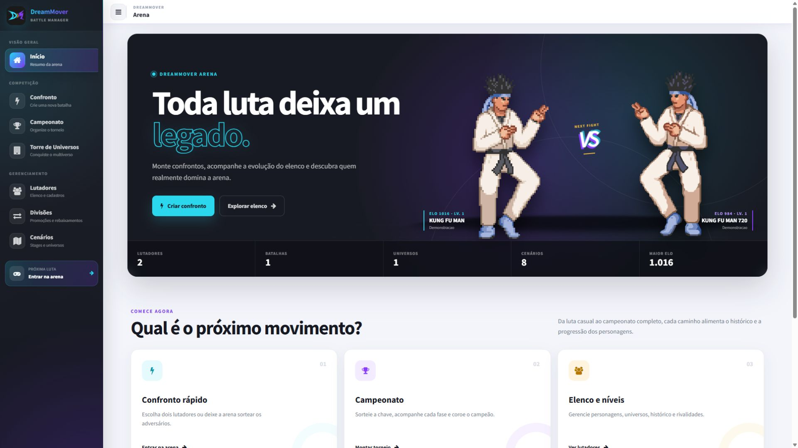
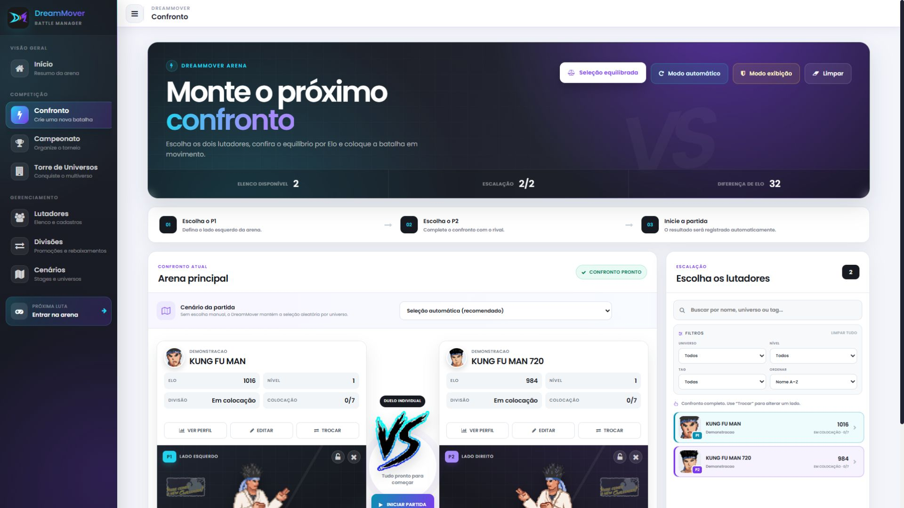
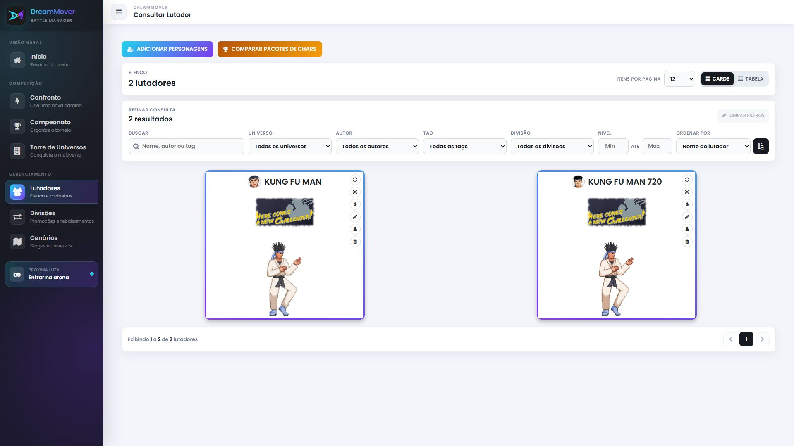

# DreamMover

Aplicação para Windows que organiza personagens, cenários e competições de jogos de luta compatíveis com M.U.G.E.N e IKEMEN GO. O sistema inicia combates no IKEMEN, registra o placar e atualiza a experiência, o nível e o ranking Elo dos participantes.

Esta é a edição de portfólio, com um banco de demonstração independente e os recursos padrão das engines.

[](docs/screenshots/arena.jpg)

## Funcionalidades

- Cadastro e edição de lutadores, universos, tags, imagens e atributos.
- Partidas com seleção manual ou automática, histórico e rivalidades.
- Experiência, progressão de nível, ranking Elo e divisões competitivas.
- Campeonatos eliminatórios e Torre de Universos.
- Catálogo de cenários e sequências de cenários por round.
- Importação de pacotes de personagens e cenários e extração de imagens.
- Histórico de alterações de personagens.

## Capturas do sistema

Capturas reais da demonstração em **1920 × 1080**. Clique nas imagens para visualizar em tamanho completo.

| Criação de confrontos | Gerenciamento do elenco |
| --- | --- |
| [](docs/screenshots/confronto.jpg) | [](docs/screenshots/elenco.jpg) |

## Tecnologias

C#, ASP.NET MVC 5, .NET Framework 4.7.2, Entity Framework 6 com modelo database-first, SQL Server, Vue.js carregado diretamente nas páginas e Bootstrap. Não há etapa de instalação com npm.

## Executar no Windows

### Pré-requisitos

- Visual Studio 2022 com a carga **Desenvolvimento para ASP.NET e Web**, IIS Express e o targeting pack do .NET Framework 4.7.2.
- SQL Server Express LocalDB; a configuração padrão usa `(localdb)\MSSQLLocalDB`.
- PowerShell 5.1. Node.js é necessário somente para executar o teste JavaScript.

### Preparação

1. Abra `DreamMover.sln` no Visual Studio, restaure os pacotes NuGet e compile em **Release**.
2. Na pasta do projeto, execute:

   ```powershell
   powershell -NoProfile -ExecutionPolicy Bypass -File tools\Install-Engines.ps1
   powershell -NoProfile -ExecutionPolicy Bypass -File tools\Initialize-Demo.ps1
   powershell -NoProfile -ExecutionPolicy Bypass -File tools\Start-Demo.ps1
   ```

3. Acesse [http://localhost:55820](http://localhost:55820).

O ZIP completo da Release já inclui a aplicação compilada e as engines. Nesse pacote, execute `Initialize-Demo.ps1` e `Start-Demo.ps1`; a compilação e o download das engines são opcionais.

O instalador baixa duas versões fixadas e verifica os hashes SHA-256 antes de extrair em `Engines/Mugen` e `Engines/Ikemen`. O pacote completo de demonstração já contém essas pastas; nesse caso, o instalador preserva as engines existentes.

O banco **DreamMoverPortfolio** recebe as tabelas, migrações e dois personagens de exemplo: Kung Fu Man e Kung Fu Man 720. Não é necessário copiar um banco pessoal. As migrações aplicadas são registradas para que repetir a preparação não reconstrua o ranking. O primeiro acesso sincroniza os cenários disponíveis.

Para outro SQL Server com autenticação do Windows:

```powershell
powershell -NoProfile -ExecutionPolicy Bypass -File tools\Initialize-Demo.ps1 -ServerInstance '.\SQLEXPRESS'
```

`ConnectionStrings.config` é criado localmente e ignorado pelo Git. Para configurações específicas, copie `AppSettings.local.example.config` para `AppSettings.local.config`. Os caminhos relativos são resolvidos a partir da pasta da aplicação.

## Roteiro de demonstração

1. Em **Lutadores**, confira os dois personagens de exemplo. É possível importar suas imagens a partir das engines.
2. Em **Confronto**, desmarque **Divisões ativas** para usar o **Modo exibição**, selecione os dois lutadores e inicie a partida. Os dois personagens iniciais ainda não possuem uma divisão estabelecida.
3. Ao término, veja o placar, a atualização de Elo e a experiência recebida.
4. Consulte os detalhes do personagem para mostrar o histórico e as rivalidades.
5. Explore **Campeonato**, **Divisões** e **Torre de Universos**. Algumas competições exigem ampliar o elenco; os pacotes mínimos trazem apenas personagens de exemplo.

## Arquitetura e testes

Os controllers atendem as requisições MVC, os serviços concentram regras de competição e integração, o Entity Framework acessa o SQL Server e as views Razor hospedam os componentes Vue. Consulte [as decisões de arquitetura](docs/arquitetura.md).

Depois de compilar:

```powershell
powershell -NoProfile -ExecutionPolicy Bypass -File tools\Test-Portfolio.ps1
```

Os testes usam dados e arquivos temporários. Cobrem progressão/Elo, divisões, torre, importação de arquivos, leitura dos resultados do IKEMEN, cenários, histórico e seleção automática. Não dependem do banco pessoal nem do acervo de personagens do desenvolvedor.

Consulte [a validação desta edição](docs/validacao.md) e [a tela de confronto](docs/screenshots/confronto.jpg).

## Limites da demonstração

A aplicação foi projetada para execução local no Windows e abre processos gráficos das engines na mesma máquina. A interface no navegador não torna os combates executáveis em um servidor web comum. Não publique essa aplicação como serviço aberto na internet sem um projeto específico de autenticação, isolamento e hospedagem.

Os combates iniciados pela interface usam o IKEMEN GO. O M.U.G.E.N está incluído como engine compatível e base do catálogo de recursos; seu executável também pode ser iniciado diretamente.

## Licenças e créditos

O código do DreamMover usa [MIT](LICENSE). Engines, bibliotecas, personagens, fontes e outros recursos mantêm suas licenças próprias: a licença MIT do projeto não os relicencia. O pacote de demonstração que inclui M.U.G.E.N e seus recursos padrão é distribuído gratuitamente para fins não comerciais. Consulte [as origens, versões e licenças](Engines/README.md) e a pasta `licenses`.

Desenvolvido por [Caio da Silva Pereira](https://github.com/CaioSPereira21).
